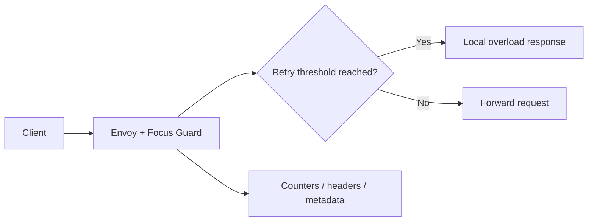

# Technical Specification — Focus Guard

## Overview

Rust Envoy dynamic module that enforces deterministic HTTP retry thresholds and returns explicit pass/throttle outcomes with observability signals.

## Problem statement

Incident response paths often accumulate retry noise that obscures root cause and increases operator cognitive load.

## Solution summary

An in-path Envoy filter reads `x-envoy-attempt-count`, applies threshold-based throttling, optionally delegates sub-threshold decisions to asynchronous TARS callouts, and emits metrics, metadata, and response headers.

## Architecture

### Components

| Component | Responsibility |
|-----------|----------------|
| `src/` | Filter implementation, config parsing, TARS integration |
| `Cargo.toml` | Rust crate metadata and dependencies |
| `STORYBOARD.md` | Demo and validation documentation |

## Tech stack

| Layer | Technology |
|-------|------------|
| Language | Rust |
| Runtime | Envoy dynamic module |
| Tooling | Built On Envoy CLI (`boe`), Cargo |
| Optional AI | TARS async callouts (disabled by default) |

## Interfaces

### APIs / entry points

- Envoy HTTP filter on configured routes
- Local validation via `boe run --local .`

### Configuration

JSON filter config: `retry_threshold`, `overload_status_code`, `overload_body`, `enable_tars`, TARS cluster settings

## Data and persistence

- Stateless per-request decisions; telemetry via Envoy metrics and dynamic metadata namespace `focus_guard`.

## Deployment

- **Target:** Envoy proxy with dynamic module loading
- **Build:** `cargo test`; `boe run --local .`
- **Run:** Local BOE instance on port `10000` by default
- **Health:** Exercised via `curl` with `x-envoy-attempt-count` header

## Testing strategy

| Layer | Command | Coverage |
|-------|---------|----------|
| Unit | `cargo test` | Config parsing, pass/throttle paths, TARS callbacks |
| Manual | `curl` scenarios in README | Threshold behavior |

## Security and reliability notes

- TARS callouts are asynchronous and non-blocking inside stream callbacks.
- Fail-open/fail-closed behavior configurable when TARS is enabled.

## Evidence map (reviewer paths)

| Concern | Path |
|---------|------|
| Filter implementation | `src/` |
| Demo documentation | `STORYBOARD.md` |
| Crate manifest | `Cargo.toml` |

## Architecture decisions

Record significant decisions in `docs/adr/`. Start with `docs/adr/0001-record-architecture-decisions.md`.

---

**Maintained by:** [Dark Heart Labs](https://darkheartlabs.technology)  
**Author:** Jennifer ([@jv-darkheartlabs](https://github.com/jv-darkheartlabs))  
**Site:** https://darkheartlabs.technology
